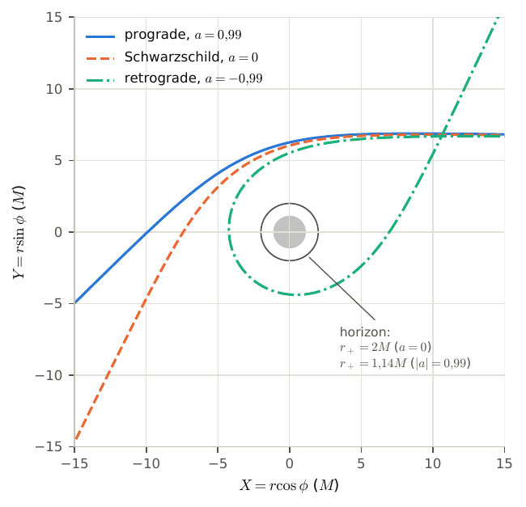
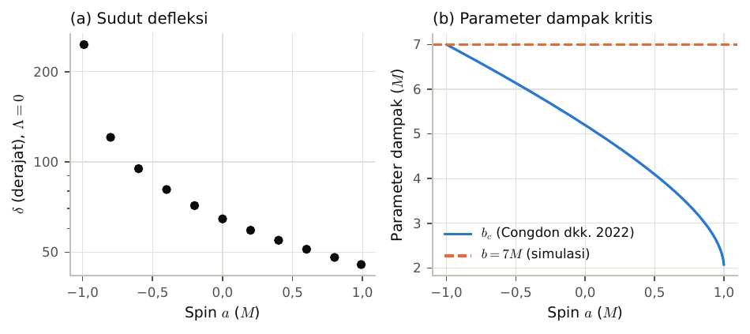
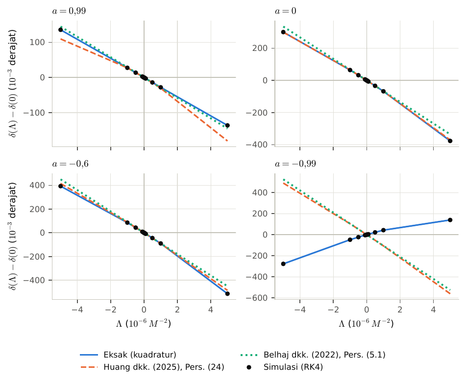
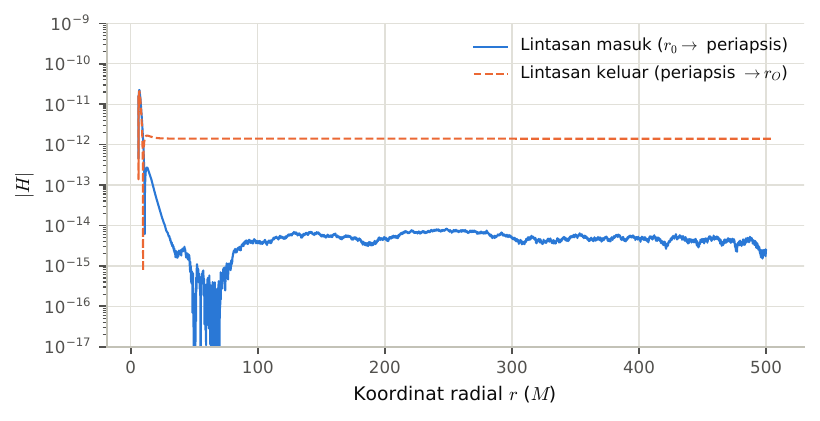

# How Light Bends Around a Spinning Black Hole

[](https://www.python.org/)
[](LICENSE)

Light normally travels in a straight line. Near something very heavy, such as a black hole, its path
**bends**. This effect is called *gravitational lensing*. Astronomers use it to weigh galaxies and to
find dark matter.

This project is a computer simulation of that bending. It asks two questions:

1. **Does it matter that the black hole is spinning?**
2. **Does it matter that the universe is expanding?** The expansion is driven by *dark energy*.
   Physicists describe it with a number called the **cosmological constant**, written **Λ** (lambda).

The code was written for an undergraduate (S1) physics thesis at Universitas Tanjungpura.

## The idea in one picture

<p align="center">
  
</p>

Each line is a ray of light that comes in from the right and passes the black hole (the grey disc at
the centre). All three rays start out the same way. The only difference is how the black hole spins:

- **Blue (prograde):** the black hole spins *in the same direction* the light is moving. The light
  gets a "push" and bends the least.
- **Orange (Schwarzschild):** the black hole does not spin.
- **Green (retrograde):** the black hole spins *against* the light. The light is pulled much harder.
  It loops almost all the way around before it escapes.

The **deflection angle** is how much the light's direction changes between where it starts and where
it ends up. It is the main quantity this project measures.

## What we found

### 1. Spin matters a lot

<p align="center">
  
</p>

**Left panel:** the deflection angle (vertical axis, in degrees) for different spins (horizontal
axis). Negative spin means the black hole turns against the light. The more it turns against the
light, the more the light bends: about 45° for the fastest prograde spin, and more than 200° for the
fastest retrograde spin.

**Right panel:** why this happens. Every black hole has a "point of no return" for passing light,
called the *critical impact parameter* (blue line). A ray that passes closer than this falls in. Our
rays all pass at the same distance (orange dashed line). For the fastest retrograde spin, that is
just barely outside the point of no return.

### 2. The expanding universe makes light bend slightly less

<p align="center">
  
</p>

Each panel shows a different spin. The horizontal axis is the cosmological constant Λ, and the
vertical axis is how much the deflection angle changes compared with a universe without Λ. The
black dots are our simulation. The coloured lines are predictions from formulas published by other
researchers.

- A positive Λ (an expanding universe, like ours) makes the light bend **slightly less**. A negative Λ
  makes it bend slightly more. The effect is tiny: at most about half a degree, even for a Λ far larger
  than the real one.
- The simulation agrees with the published formulas of Belhaj et al. (2022) and Huang et al. (2025).
- **Exception (bottom right):** when the light passes just outside the point of no return, the trend
  reverses. The simple formulas no longer work there, but the simulation still matches an exact
  calculation.

### 3. The simulation is accurate

<p align="center">
  
</p>

The laws of physics require a quantity called $H$ to stay exactly zero along the path of light.
On a computer it can only be approximately zero, so its size measures the numerical error. Along
the whole path it stays below $10^{-10}$ (one ten-billionth). The deflection angles also agree with
an independent, exact calculation to within one millionth of a degree.

## How it works (briefly)

1. **Describe the space around the black hole.** The black hole and the expanding universe together
   are described by Einstein's general relativity, in a solution called the *Kerr–de Sitter*
   spacetime.
2. **Write down the rules for light.** From that description the program derives the equations of
   motion for light, using the symbolic math library SymPy.
3. **Follow the light step by step.** Starting far from the black hole, the program moves the light
   forward in tens of thousands of small steps (the Runge–Kutta method). It records the path until
   the light is far away again.
4. **Measure the angle and check it.** The deflection angle is measured the same way as in the
   research articles, then compared with exact calculations and published formulas.

<details>
<summary><b>Technical details for physicists</b></summary>

- Null geodesics in the equatorial plane of Kerr–de Sitter spacetime, in Boyer–Lindquist coordinates
  with $G = c = M = 1$ and $\Delta_r = (r^2+a^2)(1 - \Lambda r^2/3) - 2Mr$.
- Hamiltonian $H = \tfrac12 g^{\mu\nu}p_\mu p_\nu$. The exact inverse metric is derived with SymPy,
  cached on disk, and compiled to fast numerical functions.
- Fixed-step RK4 with $\Delta\tau = 0.05$. Source at $r_0 = 500M$, impact parameter $b = 7M$. The
  photon counts as captured if $r < 1.1\,r_+$.
- Finite-distance deflection angle (Ishihara et al. 2016), as used by Belhaj et al. (2022) and Huang
  et al. (2025): $\delta = \Psi_O - \Psi_S + \phi_{OS}$, where the angles are measured by static
  observers. The coordinate value $\lvert\phi_{OS} - \pi\rvert$ used in the original thesis tables is
  still available as `deflection_legacy_deg`. It responds to $\Lambda$ with the opposite sign.
- Validation: $\max\lvert H\rvert \approx 2\times10^{-11}$. Agreement with an exact quadrature
  benchmark to $\lesssim 10^{-6}$ degrees, and with literature values (Hasanuddin 2012) and analytic
  formulas in the weak field. Regression tests guarantee trajectories identical to the original code.
- Curve fits: $\delta = A\lvert\Lambda\rvert^B + C$ and $\delta(a) = A e^{-Ba} + C$, with parameter
  uncertainties and $R^2$.

| Version | Deflection angle | Use |
|---|---|---|
| Tag [`skripsi-v1.0`](https://github.com/NugiePhysics/Research-thesis-s1/tree/skripsi-v1.0) | Coordinate value $\lvert\phi_{OS} - \pi\rvert$ | Code behind the tables of the thesis manuscript |
| `main` | Finite-distance angle of the articles | Current results |

</details>

## Try it yourself

You need Python 3.10 or newer. Download the code and install it:

```bash
git clone https://github.com/NugiePhysics/Research-thesis-s1.git
cd Research-thesis-s1
python -m venv .venv
source .venv/bin/activate      # on Windows: .venv\Scripts\activate
pip install -e ".[dev]"
```

Then open one of the notebooks in Jupyter or VS Code (select the `.venv` kernel) and click
**Run All**:

| Notebook | What it shows | Run time* |
|---|---|---|
| [`Lambda_Deflection.ipynb`](notebooks/Lambda_Deflection.ipynb) | How the bending changes with Λ: light paths, accuracy checks, comparison with the articles | ~1 min |
| [`Spin_Deflection.ipynb`](notebooks/Spin_Deflection.ipynb) | How the bending changes with spin | ~5 min |
| [`Validation.ipynb`](notebooks/Validation.ipynb) | Comparison with published values and exact calculations | ~2.5 min |

\*On a 4-core laptop. The first run on a new computer takes longer, usually about a minute more.
During that run the program derives the equations and saves them for later.

You can change all the settings (spin, Λ, distance of the light ray, …) in the *Parameters* cell at
the top of each notebook.

<details>
<summary><b>Using the code from Python</b></summary>

```python
import numpy as np
from kerr_ds import kerr_horizon_radius, run_lambda_sweep

if __name__ == "__main__":  # required for multiprocessing in scripts
    M, a, b, E = 1.0, 0.99, 7.0, 1.0
    results = run_lambda_sweep(
        M, a, lambdas=[0.0, 1e-6, 5e-6],
        r0=500.0, theta0=np.pi / 2, phi0=0.0, E=E, L_ang=b * E,
        r_horizon=kerr_horizon_radius(M, a),
    )
    for res in results:
        print(res.lmd, res.deflection_deg)
```

The `kerr_ds.analytic` module provides the exact deflection angle (`deflection_exact_deg`) and the
formulas of Huang et al. (2025) and Belhaj et al. (2022). Run the tests with `pytest`.

</details>

## What's in this repository

```
src/kerr_ds/     the physics code (equations, step-by-step solver, analysis, plots)
notebooks/       ready-to-run notebooks that reproduce the results
tests/           automatic checks that the results stay correct
images/          the figures shown on this page
```

## License

The code is released under the [MIT License](LICENSE). The figures in [`images/`](images/) come from
the final thesis report and are licensed under
[CC BY 4.0](https://creativecommons.org/licenses/by/4.0/).

## Author

**NugiePhysics** (Nugie Saputra). Undergraduate (S1) thesis in physics, Universitas Tanjungpura.
