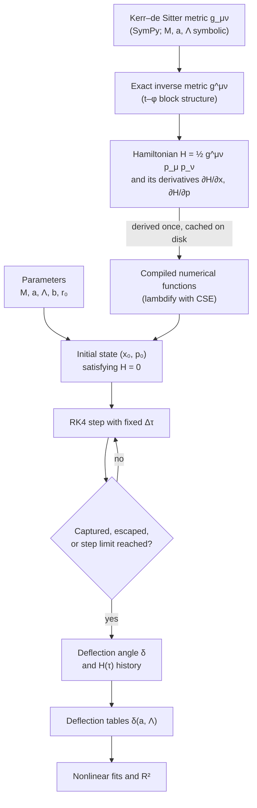

# Methodology

This document describes the computational methodology used to compute the deflection of light in
Kerr–de Sitter spacetime: the metric, the Hamiltonian formulation of null geodesics, the initial
conditions, the numerical integrator, the definition of the deflection angle, the validation
strategy, and the curve fitting. Every equation below corresponds directly to the implementation in
[`src/kerr_ds/`](../src/kerr_ds); [Section 15](#15-code-map) maps each concept to the relevant
module and function.

## Contents

1. [Overview](#1-overview)
2. [Spacetime metric](#2-spacetime-metric)
3. [Inverse metric](#3-inverse-metric)
4. [Hamiltonian formulation](#4-hamiltonian-formulation)
5. [Initial conditions](#5-initial-conditions)
6. [Numerical integration](#6-numerical-integration)
7. [Termination criteria](#7-termination-criteria)
8. [Deflection angle](#8-deflection-angle)
9. [Validation](#9-validation)
10. [Curve fitting](#10-curve-fitting)
11. [Simulation parameters](#11-simulation-parameters)
12. [Output quantities](#12-output-quantities)
13. [Limitations](#13-limitations)
14. [Data provenance](#14-data-provenance)
15. [Code map](#15-code-map)
16. [References](#16-references)

---

## 1. Overview

### 1.1 Pipeline

### 1.2 Conventions

- **Geometrized units**, $G = c = 1$, with $M = 1$ in all runs. Lengths ($r$, $b$, $r_0$) are therefore
  expressed in units of $M$ (i.e. $GM/c^2$), and $\Lambda$ in units of $M^{-2}$.
- Metric signature $(-,+,+,+)$; Boyer–Lindquist coordinates $(t, r, \theta, \phi)$.
- Angles are reported in **degrees**.

## 2. Spacetime metric

The Kerr–de Sitter metric is built from the auxiliary functions

$$
\Sigma = r^2 + a^2\cos^2\theta, \qquad
\Delta_r = (r^2 + a^2)\left(1 - \frac{\Lambda r^2}{3}\right) - 2Mr, \qquad
\Delta_\theta = 1 + \frac{\Lambda a^2 \cos^2\theta}{3}, \qquad
\Xi = 1 + \frac{\Lambda a^2}{3}.
$$

The implemented line element is

$$
ds^2 = -\frac{\Delta_r}{\Sigma}\left(dt - \frac{a\sin^2\theta}{\Xi}\,d\phi\right)^2
+ \frac{\Delta_\theta \sin^2\theta}{\Sigma}\left(a\,dt - \frac{r^2 + a^2}{\Xi}\,d\phi\right)^2
+ \frac{\Sigma}{\Delta_r}\,dr^2 + \frac{\Sigma}{\Delta_\theta}\,d\theta^2,
$$

with non-zero components

$$
g_{tt} = -\frac{\Delta_r}{\Sigma} + \frac{\Delta_\theta\sin^2\theta}{\Sigma}\,a^2, \qquad
g_{t\phi} = \frac{\Delta_r}{\Sigma}\,\frac{a\sin^2\theta}{\Xi} - \frac{\Delta_\theta\sin^2\theta}{\Sigma}\,\frac{a(r^2+a^2)}{\Xi},
$$

$$
g_{\phi\phi} = -\frac{\Delta_r}{\Sigma}\left(\frac{a\sin^2\theta}{\Xi}\right)^2 + \frac{\Delta_\theta\sin^2\theta}{\Sigma}\left(\frac{r^2+a^2}{\Xi}\right)^2, \qquad
g_{rr} = \frac{\Sigma}{\Delta_r}, \qquad
g_{\theta\theta} = \frac{\Sigma}{\Delta_\theta}.
$$

**Remarks**

- The form commonly quoted in the literature [[1]](#16-references) carries a factor $1/\Xi$ inside both
  squared brackets, i.e. $(dt - a\sin^2\theta\,d\phi)/\Xi$. The implemented form is identical after the
  time rescaling $t_\text{code} = t_\text{std}/\Xi$; quantities conjugate to $t$ (such as $E = -p_t$) follow
  the $t_\text{code}$ normalization. For $\Lambda = 5\times10^{-6}$ and $a = 0.99$, $\Xi - 1 \approx 1.6\times10^{-6}$.
- $\Lambda > 0$ gives Kerr–de Sitter, $\Lambda < 0$ Kerr–anti-de Sitter (used by the regression baseline),
  $\Lambda = 0$ reduces to Kerr, and $a = 0$ to Schwarzschild–de Sitter.
- Horizons are the roots of $\Delta_r = 0$. For $M = 1$, $a = 0.99$, the event horizon is
  $r_+ = 1.141067$ for $\Lambda = 0$ and $r_+ = 1.141085$ for $\Lambda = 5\times10^{-6}$; the cosmological
  horizon for $\Lambda = 5\times10^{-6}$ is $r_c \approx 773.6$ (close to $\sqrt{3/\Lambda}$). There is no
  cosmological horizon for $\Lambda \le 0$.

## 3. Inverse metric

Only $t$ and $\phi$ are coupled, so the inverse metric follows from the inverse of the $2\times2$
$(t,\phi)$ block plus two diagonal entries:

$$
D = g_{tt}\,g_{\phi\phi} - g_{t\phi}^2, \qquad
g^{tt} = \frac{g_{\phi\phi}}{D}, \qquad
g^{t\phi} = -\frac{g_{t\phi}}{D}, \qquad
g^{\phi\phi} = \frac{g_{tt}}{D}, \qquad
g^{rr} = \frac{1}{g_{rr}}, \qquad
g^{\theta\theta} = \frac{1}{g_{\theta\theta}}.
$$

The result is exact (symbolic), but much faster to derive and considerably more compact than a
generic `Matrix.inv()`. It is checked against `numpy.linalg.inv` at random points
(see [Section 9](#9-validation)).

## 4. Hamiltonian formulation

Geodesics are treated as a Hamiltonian system with

$$
H(x, p) = \tfrac12\, g^{\mu\nu}(x)\, p_\mu p_\nu,
\qquad
\frac{dx^\mu}{d\tau} = \frac{\partial H}{\partial p_\mu},
\qquad
\frac{dp_\mu}{d\tau} = -\frac{\partial H}{\partial x^\mu},
$$

where $\tau$ is an affine parameter. The first equation gives $dx^\mu/d\tau = g^{\mu\nu}p_\nu$, and the
pair is equivalent to the geodesic equation.

- **Null constraint.** Photons satisfy $H = 0$. The constraint is imposed through the initial
  conditions ([Section 5](#5-initial-conditions)) and is *not* enforced during integration, so the value
  of $H$ along the trajectory serves as a measure of numerical error ([Section 9](#9-validation)).
- **Conserved quantities.** The metric is independent of $t$ and $\phi$, so $\partial H/\partial t$ and
  $\partial H/\partial \phi$ vanish identically at the symbolic level. Consequently $p_t$ and $p_\phi$ are
  conserved *exactly*, including in floating-point arithmetic, because the RK4 increments of these
  components are identically zero:

  $$
  E \equiv -p_t, \qquad L \equiv p_\phi, \qquad b \equiv L/E \quad \text{(impact parameter)}.
  $$

- **Equatorial motion.** With $\theta_0 = \pi/2$ and $p_\theta = 0$ the photon remains in the equatorial
  plane by reflection symmetry.

**Implementation.** `symbolic.py` constructs the metric with $M$, $a$, $\Lambda$ as symbols, derives
$H$ (simplified with `sympy.simplify`) and its partial derivatives **once**, and caches the result in
`~/.cache/kerr_ds/`. `kerr_de_sitter.py` compiles these expressions into numerical functions with
`sympy.lambdify(..., 'math', cse=True)`, taking arguments
$(t, r, \theta, \phi, p_t, p_r, p_\theta, p_\phi, M, a, \Lambda)$; $\partial H/\partial x$ and
$\partial H/\partial p$ are evaluated in a single call.

## 5. Initial conditions

The photon is launched from

$$
x_0 = (t, r, \theta, \phi) = (0,\; r_0,\; \pi/2,\; 0), \qquad
p_0 = (p_t, p_r, p_\theta, p_\phi) = (-E,\; p_r,\; 0,\; L), \qquad L = bE,
$$

where $p_r$ is fixed by the null constraint $H = 0$:

$$
g^{tt}E^2 - 2g^{t\phi}EL + g^{\phi\phi}L^2 + g^{rr}p_r^2 = 0
\quad\Longrightarrow\quad
p_r = -\sqrt{-\,\frac{g^{tt}E^2 - 2g^{t\phi}EL + g^{\phi\phi}L^2}{g^{rr}}}.
$$

- The negative root selects an **ingoing** photon ($r$ decreasing).
- $L > 0$ means $\phi$ increases. For $a > 0$ the photon co-rotates with the black hole (prograde);
  for $a < 0$ it counter-rotates (retrograde).
- A run is skipped (message `Skipping L=…: Initial condition invalid`) if $p_r^2 < 0$ (the starting point
  lies in a classically forbidden region) or if $\lvert g^{rr}\rvert < 10^{-10}$ (the starting point is
  effectively on a horizon).

## 6. Numerical integration

The system $(x, p)$ is integrated with the classical fourth-order Runge–Kutta method (RK4) using a
fixed step $\Delta\tau$. With $\partial_x H$ and $\partial_p H$ evaluated at the indicated points,

$$
\begin{aligned}
k_1 &= -\partial_x H(x_n,\, p_n)\,\Delta\tau, &
l_1 &= \partial_p H(x_n,\, p_n)\,\Delta\tau, \\
k_2 &= -\partial_x H(x_n + \tfrac12 l_1,\, p_n + \tfrac12 k_1)\,\Delta\tau, &
l_2 &= \partial_p H(x_n + \tfrac12 l_1,\, p_n + \tfrac12 k_1)\,\Delta\tau, \\
k_3 &= -\partial_x H(x_n + \tfrac12 l_2,\, p_n + \tfrac12 k_2)\,\Delta\tau, &
l_3 &= \partial_p H(x_n + \tfrac12 l_2,\, p_n + \tfrac12 k_2)\,\Delta\tau, \\
k_4 &= -\partial_x H(x_n + l_3,\, p_n + k_3)\,\Delta\tau, &
l_4 &= \partial_p H(x_n + l_3,\, p_n + k_3)\,\Delta\tau,
\end{aligned}
$$

$$
p_{n+1} = p_n + \tfrac16\,(k_1 + 2k_2 + 2k_3 + k_4), \qquad
x_{n+1} = x_n + \tfrac16\,(l_1 + 2l_2 + 2l_3 + l_4).
$$

- Step size $\Delta\tau = 0.05$, at most 30,000 steps. A scattered trajectory starting at $r_0 = 500$
  takes about 20,100–20,400 steps.
- Local error $O(\Delta\tau^5)$, global error $O(\Delta\tau^4)$. This is confirmed empirically: halving the
  step to $\Delta\tau = 0.025$ reduces $\max\lvert H\rvert$ from $2.2\times10^{-11}$ to $1.4\times10^{-12}$, a factor of
  $16 = 2^4$.
- RK4 is not symplectic, so $H$ is not preserved exactly; it is therefore monitored throughout
  ([Section 9](#9-validation)).

## 7. Termination criteria

After every step, `trace_photon` checks the following conditions:

| Condition | Interpretation |
|---|---|
| $r < 1.1\,r_+$, with $r_+ = M + \sqrt{M^2 - a^2}$ | photon captured by the black hole |
| $r > r_0 + 5$ and more than 10 steps taken | photon scattered back to large radius |
| step count reaches `max_steps` | iteration limit |

- $r_+$ is the **Kerr** event horizon ($\Lambda = 0$). It differs from the true Kerr–de Sitter horizon by
  only $\sim 2\times10^{-5}\,M$ for $\Lambda = 5\times10^{-6}$; the factor 1.1 provides a safety margin because
  Boyer–Lindquist coordinates are singular at the horizon.
- The step counter is incremented only when no termination condition is met. For a trajectory that
  terminates by capture or escape, the number of stored points is therefore `steps + 1` (e.g. the
  regression baseline has `steps` = 20,374 and 20,375 points). This value is reported in the "Status"
  column of the output table.

## 8. Deflection angle

### 8.1 Definition used by the code (main articles)

The deflection angle reported by the code, `TrajectoryResult.deflection_deg`, is the finite-distance
deflection angle of Ishihara et al. [[3]](#16-references). This is the definition used by Belhaj et al.
[[4]](#16-references) (Eq. 2.1) and Huang et al. [[5]](#16-references) (Eq. 12):

$$
\delta = \Psi_O - \Psi_S + \phi_{OS} \qquad \text{(converted to degrees)},
$$

where $\phi_{OS} = \phi_\text{final} - \phi_0$ is the azimuth swept from the source (the start of the
trajectory, $r_S = r_0$) to the observer (the end of the trajectory, the first step with $r > r_0 + 5$).
$\Psi_S$ and $\Psi_O$ are the angles between the ray and the outward radial direction, measured by static
observers (4-velocity $u \propto \partial_t$) at the source and at the observer. In the static observer's
orthonormal frame,

$$
\tan\Psi = \frac{p_{\hat\phi}}{p_{\hat r}}, \qquad
p_{\hat r} = \frac{p_r}{\sqrt{g_{rr}}}, \qquad
p_{\hat\phi} = \frac{p_\phi - (g_{t\phi}/g_{tt})\,p_t}{\sqrt{g_{\phi\phi} - g_{t\phi}^2/g_{tt}}},
$$

evaluated with `atan2` so that $\Psi_S \approx \pi$ for the ingoing photon at the source and
$\Psi_O \approx 0$ at the observer (`KerrDeSitter.static_observer_angle`). These are also the angles in the
Randers optical space of Huang et al.: the Riemannian part of the Randers metric is conformal to the static
observer's spatial metric.

- In flat space $\delta = 0$ exactly. For $\Lambda = 0$ and $r_S, r_O \to \infty$, $\delta$ becomes the usual
  asymptotic deflection angle. For Schwarzschild–de Sitter,
  $\sin\Psi_O = b\sqrt{1 - 2M/r_O - \Lambda r_O^2/3}\,/\,r_O$.
- Values $\delta > 180^\circ$ indicate that the photon winds around the black hole at least once before
  escaping (e.g. $a = -0.99$, $b = 7$ gives $\delta \approx 246^\circ$).
- $\delta$ is only meaningful for scattered photons. It is NaN for captured photons, for runs that reach
  `max_steps` (`result.escaped` is `False`), and where no static observer exists ($g_{tt} \ge 0$).

### 8.2 Coordinate and legacy values

Two further quantities are kept:

| Attribute | Definition | Remarks |
|---|---|---|
| `deflection_coord_deg` | $\phi_{OS} - \pi$ (signed) | Contains the flat-space offset $-[\arcsin(b/r_S) + \arcsin(b/r_O)]$, about $-1.6^\circ$ for $b = 7$ |
| `deflection_legacy_deg` | $\lvert\phi_{OS} - \pi\rvert$ | Value of the original research code, used in the thesis tables; `format_legacy_table` reproduces the original table |

The coordinate value and $\delta$ depend on $\Lambda$ with **opposite signs**. The coordinate sweep
$\phi_{OS}$ alone grows with $\Lambda$ (Huang et al., Sec. 4.1.2). In Schwarzschild–de Sitter, $\Lambda$ enters
the orbit only through $1/b_\text{eff}^2 = 1/b^2 + \Lambda/3$, because the orbit equation
$d^2u/d\phi^2 + u = 3Mu^2$ does not contain $\Lambda$ [[2]](#16-references). In Kerr–de Sitter, the
Boyer–Lindquist $\phi$ also rotates at large $r$ ($\omega = -g_{t\phi}/g_{\phi\phi} \to a\Lambda/3$), which adds
about $a\Lambda(r_S + r_O)/3$. The measured angles $\Psi$ carry the dominant term
$-\Lambda b\,(1/u_S + 1/u_O)/6$ (Huang et al., Eq. 24). As a result, $\delta$ **decreases** for $\Lambda > 0$,
as in the main articles. The exception is the near-critical case $a = -0.99$, $b = 7$
($b - b_c = 0.017$), where the shift of the critical impact parameter $b_c$ dominates.

## 9. Validation

| Check | Scope | Criterion | Result |
|---|---|---|---|
| Hamiltonian constraint | every run | $H = 0$ ideally | $\max\lvert H\rvert \approx 2.2\times10^{-11}$ (main notebook) |
| Exact benchmark (quadrature) | notebooks, `pytest` | same $\delta$ from the first integrals | agreement to $\lesssim 10^{-6}$ degrees |
| Flat-space benchmark | `pytest` | $\delta = 0$ | $\lvert\delta\rvert < 10^{-7}$ degrees |
| Literature, $\Lambda = 0$ (Hasanuddin 2012) | `Validation.ipynb` | asymptotic Kerr angle | agreement after the finite-distance correction |
| Analytic formulas with $\Lambda$ (Huang 2025, Belhaj 2022) | `pytest`, main notebook | $\Lambda$ dependence of $\delta$ | same sign; within 3% / 5% in the weak field |
| Regression test | `pytest` | identical to the original code | pass |
| Inverse metric | `pytest` | matches `numpy.linalg.inv` | pass |
| Fitting and spin sweep | `pytest` | known values / synthetic data | pass |

1. **Hamiltonian constraint.** $H(x, p)$ is evaluated after every step and stored in
   `TrajectoryResult.H`. The main notebook plots it for the last trajectory, both against step number
   and against $r$ (symlog scale with `linthresh` $= 10^{-14}$, annotated at periapsis). Observed values:
   $\max\lvert H\rvert \approx 2.2\times10^{-11}$ for the main notebook ($a = 0.99$, $b = 7$) and
   $\approx 5.3\times10^{-12}$ for the regression baseline ($a = -0.99$). The error is dominated by RK4
   truncation error (it drops by a factor of 16 when $\Delta\tau$ is halved).
2. **Exact benchmark** (`analytic.deflection_exact_deg`). On the equator, with the normalisation of the
   code ($E = 1$, $L = b$, $B = \Xi b$, $P = r^2 + a^2 - aB$), the first integrals give

   $$
   R(r) = P^2 - \Delta_r (B - a)^2, \qquad
   \frac{d\phi}{dr} = \frac{\Xi\,[\,aP/\Delta_r + (B - a)\,]}{\sqrt{R(r)}}.
   $$

   $R(r)$ is a quartic, so the turning point is factored out exactly, and $\phi_{OS}$ is obtained by
   quadrature (tolerance $10^{-13}$) between the same source and observer radii as the simulation. With the
   static-observer angles this gives the exact $\delta$. Simulation and benchmark agree to about $10^{-7}$
   degrees (e.g. Schwarzschild, $b = 7$: $64.6058^\circ$; the asymptotic value is $64.6090^\circ$). In
   Schwarzschild–de Sitter the benchmark also confirms that $\phi_{OS}$ depends on $\Lambda$ only through
   $b_\text{eff}$ ([Section 8.2](#82-coordinate-and-legacy-values)).
3. **Flat-space benchmark** (`tests/test_deflection.py`). $M = 0$, $a = 0$, $\Lambda = 0$ gives
   $\lvert\delta\rvert < 10^{-7}$ degrees, and $\phi_{OS} - \pi = -[\arcsin(b/r_0) + \arcsin(b/r_\text{final})]$.
4. **Regression test** (`tests/test_regression.py`). The baseline was produced by the original notebook
   code (commit `9aeebc2`; $a = -0.99$, $\Lambda \in \{0, -10^{-8}, \dots, -5\times10^{-6}\}$, $b = 7$). The test
   requires a character-for-character identical output table (`format_legacy_table`), identical step counts,
   $\lvert\Delta\delta_\text{legacy}\rvert < 10^{-6}$ degrees, and matching $X$, $Y$ (relative tolerance $10^{-8}$) and $H$
   (absolute tolerance $10^{-13}$) at 22 sample points per trajectory. The trajectories are therefore
   unchanged by the new definition of the deflection angle.
5. **Inverse metric test.** The symbolic inverse is compared with `numpy.linalg.inv` at 20 random points
   ($r \in [3, 500]$, $\theta \in [0.1, \pi - 0.1]$, $a \in [-0.99, 0.99]$, $\Lambda \in [-5\times10^{-6}, 5\times10^{-6}]$)
   with relative tolerance $10^{-10}$.
6. **Fitting and spin-sweep tests** (`tests/test_fitting.py`). $R^2 = 1$ for a perfect prediction;
   `fit_curve` recovers the parameters of synthetic data for all models and returns their uncertainties;
   and `run_spin_sweep` for $a = 0.99$, $\Lambda = 0$ reproduces the original value of $43.9149^\circ$
   (`deflection_legacy_deg`) in 20,140 steps.
7. **Literature, $\Lambda = 0$** ([`notebooks/Validation.ipynb`](../notebooks/Validation.ipynb)). Hasanuddin
   (2012) [[7]](#16-references) gives asymptotic Kerr deflection angles for $a = 0.52$ and $0.9939$,
   $b = 5$–$40$. The simulated $\delta$ at $r_0 = 500$ is smaller than the exact asymptotic value only by the
   bending beyond $r_0$ ($0.002^\circ$–$0.018^\circ$). $\phi_{OS} - \pi$ plus the flat-space offset agrees with the
   exact asymptotic value to $4\times10^{-4}$ degrees. The legacy value differs from the literature by the
   offset itself (1.1°–9.1°; for $b = 40$ the coordinate value is negative). The literature values are
   0.08°–0.28° below the exact ones.
8. **Analytic formulas with $\Lambda$** (`tests/test_deflection.py`, main notebook). In the weak field
   ($b = 50$, $r_S = r_O = 500$, $\Lambda = 10^{-7}$) the change of $\delta$ with $\Lambda$ agrees with Huang et
   al. [[5]](#16-references), Eq. (24), to within 3% and with Belhaj et al. [[4]](#16-references), Eq. (5.1), to
   within 5%. For the thesis parameters ($b = 7$, $r_0 = 500$) the main notebook compares the simulated
   shift $\delta(\Lambda) - \delta(0)$ with both formulas. The critical impact parameter agrees with Congdon et al.
   [[6]](#16-references), Eq. (17).

Checks 1, 2 (notebooks), and 7 run in the notebooks; checks 2–6 and 8 run with `pytest`.

## 10. Curve fitting

Nonlinear least-squares fits are performed with `scipy.optimize.curve_fit` (Levenberg–Marquardt, as
no parameter bounds are imposed). Goodness of fit is quantified by the coefficient of determination

$$
R^2 = 1 - \frac{SS_\text{res}}{SS_\text{tot}}
= 1 - \frac{\sum_i \left(y_i - \hat y_i\right)^2}{\sum_i \left(y_i - \bar y\right)^2},
$$

where $y_i$ are the simulated values, $\hat y_i$ the model predictions, and $\bar y$ the sample mean. With
6–7 data points and 2–3 free parameters, $R^2$ is used here as a descriptive measure of fit quality, not
as a statistical test. `fit_curve(..., return_errors=True)` also returns the 1-sigma parameter
uncertainties (square root of the diagonal of the covariance matrix), so that, for example, an exponent
can be compared with 1.

### 10.1 Deflection versus Λ

Implemented at the end of [`notebooks/Lambda_Deflection.ipynb`](../notebooks/Lambda_Deflection.ipynb).

$$
\delta = A\,\lvert\Lambda\rvert^{B} + C, \qquad \delta = A\,\lvert\Lambda\rvert + C \ \ (\lvert\Lambda\rvert \le 10^{-6})
$$

- Data: the deflection angles $\delta$ from the main notebook ($a = 0.99$, $b = 7$), fitted separately for
  $\Lambda > 0$ and $\Lambda < 0$ against $\lvert\Lambda\rvert$ (a negative number raised to a non-integer power is
  undefined). Each set includes $\Lambda = 0$.
- $\Lambda = 0$ is represented by $\lvert\Lambda\rvert = 10^{-10}$ so that it can be shown on a logarithmic axis.
- Initial guess $p_0 = [\pm 5000,\; 1,\; \delta(0)]$ (sign of the trend), `maxfev` $= 20000$.
- Current result, $\Lambda > 0$: $A = -23250.55$, $B = 0.9869 \pm 0.0015$, $C = 45.5090$, $R^2 = 0.999999$;
  $\Lambda < 0$: $A = 23442.12$, $B = 0.9878 \pm 0.0010$, $C = 45.5090$. Linear fits for $\lvert\Lambda\rvert \le 10^{-6}$
  give slopes $-27893 \pm 5$ and $+27758 \pm 11$ degrees per unit $\Lambda$ ($M^{-2}$).
- The deflection angle decreases for $\Lambda > 0$ and increases for $\Lambda < 0$, as in the main articles. The
  small departure of $B$ from 1 comes from the higher orders in $\Lambda r_0^2$ near the cosmological horizon
  ([Section 13](#13-limitations)), so it depends on $r_0$.
- The original code fitted the legacy coordinate value instead ($A = 67445.75$, $B = 1.0844$, $C = 43.9150$),
  which increases with $\Lambda$ ([Section 8.2](#82-coordinate-and-legacy-values)).

### 10.2 Deflection versus spin

Implemented in [`notebooks/Spin_Deflection.ipynb`](../notebooks/Spin_Deflection.ipynb).

$$
\delta(a) = A\,e^{-Ba} + C
$$

- Data: a grid of 11 spins (prograde and retrograde) × 7 values of $\Lambda$ (77 trajectories, $b = 7$) from
  `run_spin_sweep`; each $\Lambda$ is fitted separately for prograde ($a \ge 0$) and retrograde ($a \le 0$) spins.
- Initial guess $p_0 = [300,\; 5,\; 70]$ (prograde) and $[1,\; 6,\; 70]$ (retrograde), `maxfev` $= 20000$.
- Current result for $\Lambda = 0$: prograde $A = 32.3813$, $B = 0.8940$, $C = 32.1902$, $R^2 = 0.999955$;
  retrograde $A = 0.4437$, $B = 6.0327$, $C = 70.9952$, $R^2 = 0.9931$ (the other values of $\Lambda$ are listed
  in the notebook).
- The exponential model is descriptive only, and fits the retrograde data poorly: for retrograde photons the
  critical impact parameter approaches $7M$ as $a \to -M$ [[6]](#16-references), so for $b = 7$ the
  deflection angle diverges logarithmically [[8]](#16-references) and the curves must not be extrapolated to
  $a = -1$.

## 11. Simulation parameters

| Parameter | Symbol | Main notebook | Spin notebook | Regression baseline |
|---|---|---|---|---|
| Mass | $M$ | 1 | 1 | 1 |
| Spin | $a$ | 0.99 | 0, ±0.2, ±0.4, ±0.6, ±0.8, ±0.99 | −0.99 |
| Cosmological constant | $\Lambda$ | 0, ±$10^{-8}$, ±$5\times10^{-8}$, ±$10^{-7}$, ±$5\times10^{-7}$, ±$10^{-6}$, ±$5\times10^{-6}$ | 0, $10^{-8}$, …, $5\times10^{-6}$ | 0, $-10^{-8}$, …, $-5\times10^{-6}$ |
| Initial radius | $r_0$ | 500 | 500 | 500 |
| Initial angles | $\theta_0$, $\phi_0$ | $\pi/2$, 0 | $\pi/2$, 0 | $\pi/2$, 0 |
| Energy | $E$ | 1 | 1 | 1 |
| Impact parameter | $b = L/E$ | 7 | 7 | 7 |
| Step size | $\Delta\tau$ | 0.05 | 0.05 | 0.05 |
| Step limit | `max_steps` | 30,000 | 30,000 | 30,000 |

Run time on a 4-core laptop CPU (with the Hamiltonian cache already populated): about 1 min for the
main notebook, about 5 min for the spin notebook, and about 2.5 min for the validation notebook.

## 12. Output quantities

| Quantity | Symbol | Unit | Purpose | In code |
|---|---|---|---|---|
| Deflection angle (definition of the main articles) | $\delta$ | degrees | primary result | `TrajectoryResult.deflection_deg` |
| Coordinate value | $\phi_{OS} - \pi$ | degrees | comparison with the original code | `TrajectoryResult.deflection_coord_deg` |
| Legacy value (thesis tables) | $\lvert\phi_{OS} - \pi\rvert$ | degrees | reproduces the original output | `TrajectoryResult.deflection_legacy_deg` |
| Static-observer angles | $\Psi_S$, $\Psi_O$ | rad | ingredients of $\delta$ | `TrajectoryResult.psi_source`, `.psi_observer` |
| Azimuth swept | $\phi_{OS}$ | rad | ingredient of $\delta$ | `TrajectoryResult.delta_phi` |
| Escape flag | – | – | `True` if scattered back to $r > r_0 + 5$ | `TrajectoryResult.escaped` |
| Step count | `steps` | – | trajectory length, run status | `TrajectoryResult.steps` |
| Hamiltonian per step | $H(\tau)$ | – | numerical error indicator (ideally 0) | `TrajectoryResult.H` |
| Projected trajectory | $X = r\cos\phi$, $Y = r\sin\phi$ | $M$ | visualization | `TrajectoryResult.X`, `.Y`, `.r` |
| Fit parameters | $A$, $B$, $C$ | – | functional dependence of $\delta$ on $\Lambda$ or $a$ | `fit_curve` |
| Coefficient of determination | $R^2$ | – | fit quality | `fit_curve`, `r_squared` |

## 13. Limitations

1. **Finite-distance deflection.** Photons start at $r_0 = 500$ and stop at $r \approx 505$. The
   deflection angle $\delta$ ([Section 8](#8-deflection-angle)) is defined at these finite distances, as in
   the main articles. It excludes the bending that would accumulate beyond $r_0$ (about $2Mb/r_0^2$ rad, i.e.
   $0.002^\circ$ for $b = 5$ and $0.018^\circ$ for $b = 40$) and is therefore slightly smaller than the
   asymptotic angle ($64.6090^\circ$ for Schwarzschild with $b = 7$, against $64.6058^\circ$ at $r_0 = 500$). For
   $\Lambda > 0$ the spacetime is not asymptotically flat, so a finite-distance definition is unavoidable.
   The literature does not agree on a single definition: Arakida (2018) measures the angle relative to the
   de Sitter background (the $O(\Lambda)$ term then vanishes), and Hu et al. (2022) find no $\Lambda$ effect
   beyond the angular-diameter distances in a cosmological (Swiss-cheese) setting. The code follows
   Ishihara et al., Belhaj et al., and Huang et al. [[3–5]](#16-references).
2. **Sensitivity to the termination point.** $r_\text{final}$ can fall anywhere in
   $(r_0 + 5,\; r_0 + 5 + \Delta r]$, with $\Delta r \approx 0.05$ per step. A shift of $0.05$ in the end radius changes
   $\delta$ by at most $2.5\times10^{-5}$ degrees (at $\Lambda = 5\times10^{-6}$; $3\times10^{-7}$ degrees at $\Lambda = 0$),
   but the coordinate value $\phi_{OS} - \pi$ by $8\times10^{-5}$ degrees, because $d\phi/dr \approx b/r^2$ there.
   Comparisons with analytic formulas should therefore use the actual end radius, `result.r[-1]`, as the
   notebooks do.
3. **Regime of the analytic formulas.** The formulas of Huang et al. and Belhaj et al. are expansions in
   $M/b$ and in $\Lambda r^2$. At $b = 7$ (only $1.35\,b_c$ for Schwarzschild) their absolute values are far
   from the exact result, so only the change with $\Lambda$ is compared. At $r_0 = 500$ the expansion
   parameter $\Lambda r_0^2/3$ is $0.083$ for $\Lambda = 10^{-6}$ but $0.42$ for $\Lambda = 5\times10^{-6}$
   ($r_0 \approx 0.65\,r_c$), where first-order formulas deviate by up to about 30%. The exact benchmark
   `analytic.deflection_exact_deg` has no such restriction.
4. **Proximity to the cosmological horizon for large Λ.** For $\Lambda = 5\times10^{-6}$,
   $\Lambda r_0^2/3 \approx 0.42$ (the factor $1 - \Lambda r^2/3$ in $\Delta_r$ is reduced to 0.58) and
   $r_c \approx 773.6$, so $r_0 \approx 0.65\,r_c$. Initial conditions are valid only for $r_+ < r_0 < r_c$.
5. **Capture criterion uses the Kerr horizon** ($\Lambda = 0$). The effect is negligible
   ([Section 7](#7-termination-criteria)) and only concerns captured photons.
6. **Fixed step size without adaptive error control.** Adequate for the parameters used here
   ($\lvert H\rvert \sim 10^{-11}$), but the error grows for impact parameters close to the critical value
   (e.g. $a = 0$, $b = 5.2$ gives $\max\lvert H\rvert \approx 2\times10^{-10}$).
7. **Equatorial orbits only** ($\theta = \pi/2$). Non-equatorial orbits ($p_\theta \ne 0$) are not covered.

## 14. Data provenance

**Definition of the deflection angle.** The original research code, the thesis tables, and earlier
revisions of this repository reported $\lvert\phi_{OS} - \pi\rvert$ (now `deflection_legacy_deg`). Since November
2026 the primary result is the finite-distance deflection angle of the main articles
([Section 8](#8-deflection-angle)); the trajectories themselves are unchanged (regression test). The
numbers below refer to the legacy value.

Earlier revisions of this repository performed the fits in two standalone scripts
(`analysis/lambda_defleksi.py` and `analysis/spin_defleksi.py`, available in the git history at
commit `9a9dca6`) using manually transcribed deflection values. The fits are now computed directly
from simulation output. Re-running the simulations against the transcribed values established the
following:

- **The earlier spin data set was generated with $b = 5.2$**, not $b = 7$. A simulation with $b = 5.2$
  reproduces the transcribed values exactly, e.g. $a = 0 \to 389.0197^\circ$, $a = 0.99 \to 69.7456^\circ$,
  $a = 0.2$ with $\Lambda = 5\times10^{-6} \to 136.5656^\circ$, and $a = 0$ with $\Lambda = 5\times10^{-6} \to 390.7879^\circ$. The
  current spin notebook uses $b = 7$ for consistency with the main notebook; set `b = 5.2` to reproduce
  the earlier figure.
- **Two transcription errors were corrected:**

  | Case | Transcribed | Simulated |
  |---|---|---|
  | $a = 0.99$, $\Lambda = 5\times10^{-8}$, $b = 7$ | 43.9156 | 43.9159 |
  | $a = 0.8$, $\Lambda = 5\times10^{-7}$, $b = 5.2$ | 77.4883 | 77.4783 |

- **Effect on the Λ fit:**

  | Data | $A$ | $B$ | $C$ | $R^2$ |
  |---|---|---|---|---|
  | Transcribed (4 decimals) | 65570.27 | 1.0820 | 43.9150 | 0.999985 |
  | Direct from simulation | 67445.75 | 1.0844 | 43.9150 | 0.999985 |

  The difference stems from the transcription error above and from rounding the earlier data to four
  decimal places.

## 15. Code map

| Concept | Module | Function / class |
|---|---|---|
| Kerr–de Sitter metric | `src/kerr_ds/symbolic.py` | `metric()` |
| Inverse metric | `src/kerr_ds/symbolic.py` | `inverse_metric()` |
| Hamiltonian and derivatives (symbolic, cached) | `src/kerr_ds/symbolic.py` | `derive_hamiltonian()` |
| Numerical evaluation of $H$ and its gradient | `src/kerr_ds/kerr_de_sitter.py` | `KerrDeSitter.H`, `KerrDeSitter.grad` |
| Initial conditions ($p_r$ from $H = 0$) | `src/kerr_ds/kerr_de_sitter.py`, `src/kerr_ds/simulation.py` | `KerrDeSitter.get_initial_pr`, `initial_state` |
| Kerr event horizon $r_+$ | `src/kerr_ds/kerr_de_sitter.py` | `kerr_horizon_radius` |
| RK4 integrator | `src/kerr_ds/integrators.py` | `RungeKutta4.step` |
| Integration loop, termination, deflection | `src/kerr_ds/simulation.py` | `trace_photon`, `TrajectoryResult` |
| Static-observer angle $\Psi$ | `src/kerr_ds/kerr_de_sitter.py` | `KerrDeSitter.static_observer_angle` |
| Exact benchmark (quadrature), asymptotic Kerr angle, $b_c$ | `src/kerr_ds/analytic.py` | `deflection_exact_deg`, `coordinate_deflection_exact_deg`, `asymptotic_kerr_deflection_deg`, `critical_impact_parameter` |
| Analytic formulas of the main articles | `src/kerr_ds/analytic.py` | `huang2025_deflection_deg`, `belhaj2022_deflection_deg` |
| Output tables (new and original format) | `src/kerr_ds/simulation.py` | `format_table`, `format_legacy_table` |
| Parallel sweeps over $\Lambda$ and over $a \times \Lambda$ | `src/kerr_ds/simulation.py` | `run_lambda_sweep`, `run_spin_sweep` |
| Fit models and $R^2$ | `src/kerr_ds/fitting.py` | `power_law`, `exponential_decay`, `r_squared`, `fit_curve` |
| Plots (trajectories, $H$, fits) | `src/kerr_ds/plotting.py` | `plot_trajectories`, `plot_hamiltonian_vs_step`, `plot_hamiltonian_vs_r`, `plot_lambda_fit`, `plot_spin_fit` |
| Deflection versus $\Lambda$, with fit | `notebooks/Lambda_Deflection.ipynb` | – |
| Deflection versus spin, with fit | `notebooks/Spin_Deflection.ipynb` | – |
| Tests | `tests/` | `test_regression.py`, `test_fitting.py` |

## 16. References

1. B. Carter, "Hamilton–Jacobi and Schrödinger separable solutions of Einstein's equations,"
   *Commun. Math. Phys.* **10**, 280–310 (1968).
2. W. Rindler and M. Ishak, "Contribution of the cosmological constant to the relativistic bending of
   light revisited," *Phys. Rev. D* **76**, 043006 (2007).
3. A. Ishihara, Y. Suzuki, T. Ono, T. Kitamura, and H. Asada, "Gravitational bending angle of light for
   finite distance and the Gauss–Bonnet theorem," *Phys. Rev. D* **94**, 084015 (2016).
4. A. Belhaj, H. Belmahi, M. Benali, and H. El Moumni, "Light deflection by rotating regular black holes
   with a cosmological constant," *Chin. J. Phys.* **80**, 229–238 (2022).
5. Y. Huang, X. Fu, Z. Lu, and X. Qin, "The influence of cosmological constant on light deflection in
   rotating spacetimes via the generalized Gibbons–Werner method," arXiv:2505.06999 (2025).
6. A. B. Congdon, S. V. Iyer, and C. R. Keeton, "Asymmetric light bending in the equatorial Kerr metric,"
   arXiv:2207.08987 (2022).
7. Hasanuddin, "Pembelokan cahaya dalam ruang waktu Kerr–Einstein," *Positron* **II**(2), 21–24 (2012).
8. V. Bozza, "Gravitational lensing in the strong field limit," *Phys. Rev. D* **66**, 103001 (2002).
