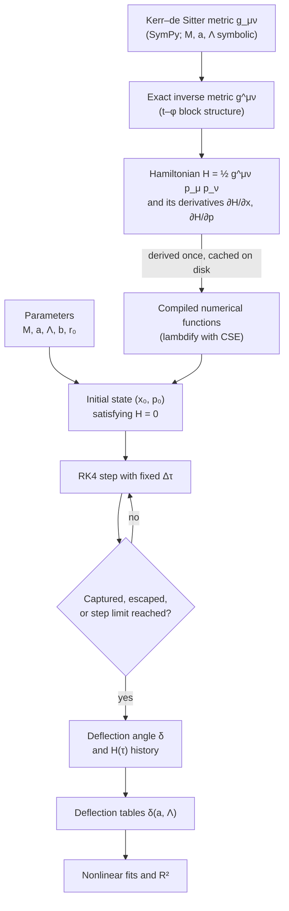

# Methodology

This document describes the computational methodology used to compute the deflection of light in
Kerr–de Sitter spacetime: the metric, the Hamiltonian formulation of null geodesics, the initial
conditions, the numerical integrator, the definition of the deflection angle, the validation
strategy, and the curve fitting. Every equation below corresponds directly to the implementation in
[`src/kerr_ds/`](../src/kerr_ds); [Section 15](#15-code-map) maps each concept to the relevant
module and function.

## Contents

1. [Overview](#1-overview)
2. [Spacetime metric](#2-spacetime-metric)
3. [Inverse metric](#3-inverse-metric)
4. [Hamiltonian formulation](#4-hamiltonian-formulation)
5. [Initial conditions](#5-initial-conditions)
6. [Numerical integration](#6-numerical-integration)
7. [Termination criteria](#7-termination-criteria)
8. [Deflection angle](#8-deflection-angle)
9. [Validation](#9-validation)
10. [Curve fitting](#10-curve-fitting)
11. [Simulation parameters](#11-simulation-parameters)
12. [Output quantities](#12-output-quantities)
13. [Limitations](#13-limitations)
14. [Data provenance](#14-data-provenance)
15. [Code map](#15-code-map)
16. [References](#16-references)

---

## 1. Overview

### 1.1 Pipeline

### 1.2 Conventions

- **Geometrized units**, $G = c = 1$, with $M = 1$ in all runs. Lengths ($r$, $b$, $r_0$) are therefore
  expressed in units of $M$ (i.e. $GM/c^2$), and $\Lambda$ in units of $M^{-2}$.
- Metric signature $(-,+,+,+)$; Boyer–Lindquist coordinates $(t, r, \theta, \phi)$.
- Angles are reported in **degrees**.

## 2. Spacetime metric

The Kerr–de Sitter metric is built from the auxiliary functions

$$
\Sigma = r^2 + a^2\cos^2\theta, \qquad
\Delta_r = (r^2 + a^2)\left(1 - \frac{\Lambda r^2}{3}\right) - 2Mr, \qquad
\Delta_\theta = 1 + \frac{\Lambda a^2 \cos^2\theta}{3}, \qquad
\Xi = 1 + \frac{\Lambda a^2}{3}.
$$

The implemented line element is

$$
ds^2 = -\frac{\Delta_r}{\Sigma}\left(dt - \frac{a\sin^2\theta}{\Xi}\,d\phi\right)^2
+ \frac{\Delta_\theta \sin^2\theta}{\Sigma}\left(a\,dt - \frac{r^2 + a^2}{\Xi}\,d\phi\right)^2
+ \frac{\Sigma}{\Delta_r}\,dr^2 + \frac{\Sigma}{\Delta_\theta}\,d\theta^2,
$$

with non-zero components

$$
g_{tt} = -\frac{\Delta_r}{\Sigma} + \frac{\Delta_\theta\sin^2\theta}{\Sigma}\,a^2, \qquad
g_{t\phi} = \frac{\Delta_r}{\Sigma}\,\frac{a\sin^2\theta}{\Xi} - \frac{\Delta_\theta\sin^2\theta}{\Sigma}\,\frac{a(r^2+a^2)}{\Xi},
$$

$$
g_{\phi\phi} = -\frac{\Delta_r}{\Sigma}\left(\frac{a\sin^2\theta}{\Xi}\right)^2 + \frac{\Delta_\theta\sin^2\theta}{\Sigma}\left(\frac{r^2+a^2}{\Xi}\right)^2, \qquad
g_{rr} = \frac{\Sigma}{\Delta_r}, \qquad
g_{\theta\theta} = \frac{\Sigma}{\Delta_\theta}.
$$

**Remarks**

- The form commonly quoted in the literature [[1]](#16-references) carries a factor $1/\Xi$ inside both
  squared brackets, i.e. $(dt - a\sin^2\theta\,d\phi)/\Xi$. The implemented form is identical after the
  time rescaling $t_\text{code} = t_\text{std}/\Xi$; quantities conjugate to $t$ (such as $E = -p_t$) follow
  the $t_\text{code}$ normalization. For $\Lambda = 5\times10^{-6}$ and $a = 0.99$, $\Xi - 1 \approx 1.6\times10^{-6}$.
- $\Lambda > 0$ gives Kerr–de Sitter, $\Lambda < 0$ Kerr–anti-de Sitter (used by the regression baseline),
  $\Lambda = 0$ reduces to Kerr, and $a = 0$ to Schwarzschild–de Sitter.
- Horizons are the roots of $\Delta_r = 0$. For $M = 1$, $a = 0.99$, the event horizon is
  $r_+ = 1.141067$ for $\Lambda = 0$ and $r_+ = 1.141085$ for $\Lambda = 5\times10^{-6}$; the cosmological
  horizon for $\Lambda = 5\times10^{-6}$ is $r_c \approx 773.6$ (close to $\sqrt{3/\Lambda}$). There is no
  cosmological horizon for $\Lambda \le 0$.

## 3. Inverse metric

Only $t$ and $\phi$ are coupled, so the inverse metric follows from the inverse of the $2\times2$
$(t,\phi)$ block plus two diagonal entries:

$$
D = g_{tt}\,g_{\phi\phi} - g_{t\phi}^2, \qquad
g^{tt} = \frac{g_{\phi\phi}}{D}, \qquad
g^{t\phi} = -\frac{g_{t\phi}}{D}, \qquad
g^{\phi\phi} = \frac{g_{tt}}{D}, \qquad
g^{rr} = \frac{1}{g_{rr}}, \qquad
g^{\theta\theta} = \frac{1}{g_{\theta\theta}}.
$$

The result is exact (symbolic), but much faster to derive and considerably more compact than a
generic `Matrix.inv()`. It is checked against `numpy.linalg.inv` at random points
(see [Section 9](#9-validation)).

## 4. Hamiltonian formulation

Geodesics are treated as a Hamiltonian system with

$$
H(x, p) = \tfrac12\, g^{\mu\nu}(x)\, p_\mu p_\nu,
\qquad
\frac{dx^\mu}{d\tau} = \frac{\partial H}{\partial p_\mu},
\qquad
\frac{dp_\mu}{d\tau} = -\frac{\partial H}{\partial x^\mu},
$$

where $\tau$ is an affine parameter. The first equation gives $dx^\mu/d\tau = g^{\mu\nu}p_\nu$, and the
pair is equivalent to the geodesic equation.

- **Null constraint.** Photons satisfy $H = 0$. The constraint is imposed through the initial
  conditions ([Section 5](#5-initial-conditions)) and is *not* enforced during integration, so the value
  of $H$ along the trajectory serves as a measure of numerical error ([Section 9](#9-validation)).
- **Conserved quantities.** The metric is independent of $t$ and $\phi$, so $\partial H/\partial t$ and
  $\partial H/\partial \phi$ vanish identically at the symbolic level. Consequently $p_t$ and $p_\phi$ are
  conserved *exactly*, including in floating-point arithmetic, because the RK4 increments of these
  components are identically zero:

  $$
  E \equiv -p_t, \qquad L \equiv p_\phi, \qquad b \equiv L/E \quad \text{(impact parameter)}.
  $$

- **Equatorial motion.** With $\theta_0 = \pi/2$ and $p_\theta = 0$ the photon remains in the equatorial
  plane by reflection symmetry.

**Implementation.** `symbolic.py` constructs the metric with $M$, $a$, $\Lambda$ as symbols, derives
$H$ (simplified with `sympy.simplify`) and its partial derivatives **once**, and caches the result in
`~/.cache/kerr_ds/`. `kerr_de_sitter.py` compiles these expressions into numerical functions with
`sympy.lambdify(..., 'math', cse=True)`, taking arguments
$(t, r, \theta, \phi, p_t, p_r, p_\theta, p_\phi, M, a, \Lambda)$; $\partial H/\partial x$ and
$\partial H/\partial p$ are evaluated in a single call.

## 5. Initial conditions

The photon is launched from

$$
x_0 = (t, r, \theta, \phi) = (0,\; r_0,\; \pi/2,\; 0), \qquad
p_0 = (p_t, p_r, p_\theta, p_\phi) = (-E,\; p_r,\; 0,\; L), \qquad L = bE,
$$

where $p_r$ is fixed by the null constraint $H = 0$:

$$
g^{tt}E^2 - 2g^{t\phi}EL + g^{\phi\phi}L^2 + g^{rr}p_r^2 = 0
\quad\Longrightarrow\quad
p_r = -\sqrt{-\,\frac{g^{tt}E^2 - 2g^{t\phi}EL + g^{\phi\phi}L^2}{g^{rr}}}.
$$

- The negative root selects an **ingoing** photon ($r$ decreasing).
- $L > 0$ means $\phi$ increases. For $a > 0$ the photon co-rotates with the black hole (prograde);
  for $a < 0$ it counter-rotates (retrograde).
- A run is skipped (message `Skipping L=…: Initial condition invalid`) if $p_r^2 < 0$ (the starting point
  lies in a classically forbidden region) or if $\lvert g^{rr}\rvert < 10^{-10}$ (the starting point is
  effectively on a horizon).

## 6. Numerical integration

The system $(x, p)$ is integrated with the classical fourth-order Runge–Kutta method (RK4) using a
fixed step $\Delta\tau$. With $\partial_x H$ and $\partial_p H$ evaluated at the indicated points,

$$
\begin{aligned}
k_1 &= -\partial_x H(x_n,\, p_n)\,\Delta\tau, &
l_1 &= \partial_p H(x_n,\, p_n)\,\Delta\tau, \\
k_2 &= -\partial_x H(x_n + \tfrac12 l_1,\, p_n + \tfrac12 k_1)\,\Delta\tau, &
l_2 &= \partial_p H(x_n + \tfrac12 l_1,\, p_n + \tfrac12 k_1)\,\Delta\tau, \\
k_3 &= -\partial_x H(x_n + \tfrac12 l_2,\, p_n + \tfrac12 k_2)\,\Delta\tau, &
l_3 &= \partial_p H(x_n + \tfrac12 l_2,\, p_n + \tfrac12 k_2)\,\Delta\tau, \\
k_4 &= -\partial_x H(x_n + l_3,\, p_n + k_3)\,\Delta\tau, &
l_4 &= \partial_p H(x_n + l_3,\, p_n + k_3)\,\Delta\tau,
\end{aligned}
$$

$$
p_{n+1} = p_n + \tfrac16\,(k_1 + 2k_2 + 2k_3 + k_4), \qquad
x_{n+1} = x_n + \tfrac16\,(l_1 + 2l_2 + 2l_3 + l_4).
$$

- Step size $\Delta\tau = 0.05$, at most 30,000 steps. A scattered trajectory starting at $r_0 = 500$
  takes about 20,100–20,400 steps.
- Local error $O(\Delta\tau^5)$, global error $O(\Delta\tau^4)$. This is confirmed empirically: halving the
  step to $\Delta\tau = 0.025$ reduces $\max\lvert H\rvert$ from $2.2\times10^{-11}$ to $1.4\times10^{-12}$, a factor of
  $16 = 2^4$.
- RK4 is not symplectic, so $H$ is not preserved exactly; it is therefore monitored throughout
  ([Section 9](#9-validation)).

## 7. Termination criteria

After every step, `trace_photon` checks the following conditions:

| Condition | Interpretation |
|---|---|
| $r < 1.1\,r_+$, with $r_+ = M + \sqrt{M^2 - a^2}$ | photon captured by the black hole |
| $r > r_0 + 5$ and more than 10 steps taken | photon scattered back to large radius |
| step count reaches `max_steps` | iteration limit |

- $r_+$ is the **Kerr** event horizon ($\Lambda = 0$). It differs from the true Kerr–de Sitter horizon by
  only $\sim 2\times10^{-5}\,M$ for $\Lambda = 5\times10^{-6}$; the factor 1.1 provides a safety margin because
  Boyer–Lindquist coordinates are singular at the horizon.
- The step counter is incremented only when no termination condition is met. For a trajectory that
  terminates by capture or escape, the number of stored points is therefore `steps + 1` (e.g. the
  regression baseline has `steps` = 20,374 and 20,375 points). This value is reported in the "Status"
  column of the output table.

## 8. Deflection angle

$$
\delta = \Bigl|\, \lvert\phi_\text{final} - \phi_0\rvert - \pi \,\Bigr| \qquad \text{(converted to degrees)},
$$

where $\phi_\text{final}$ is the value of $\phi$ at the last point of the trajectory (the first step with
$r > r_0 + 5$).

- A straight line from infinity to infinity sweeps $\Delta\phi = \pi$, so $\delta$ is the excess azimuthal
  sweep caused by gravity. Values $\delta > 180^\circ$ indicate that the photon winds around the black hole
  at least once before escaping (e.g. $a = -0.99$, $b = 7$ gives $\delta \approx 244^\circ$).
- $\delta$ is **only meaningful for scattered photons**. For captured photons, or runs that reach
  `max_steps`, the formula still returns a number but it has no physical meaning; check
  `result.r[-1]`, which is $\approx r_0 + 5$ for scattered photons.
- $\delta$ is evaluated at a finite radius and uses the coordinate angle $\phi$; see
  [Section 13](#13-limitations).

## 9. Validation

| Check | Scope | Criterion | Result |
|---|---|---|---|
| Hamiltonian constraint | every run | $H = 0$ ideally | $\max\lvert H\rvert \approx 2.2\times10^{-11}$ (main notebook) |
| Analytic Schwarzschild benchmark | one-off | exact orbit integral | agreement to 4 decimal places |
| Flat-space benchmark | one-off | straight-line geometry | agreement to 4 decimal places |
| Regression test | `pytest` | identical to the original code | pass |
| Inverse metric | `pytest` | matches `numpy.linalg.inv` | pass |
| Fitting and spin sweep | `pytest` | known values / synthetic data | pass |

1. **Hamiltonian constraint.** $H(x, p)$ is evaluated after every step and stored in
   `TrajectoryResult.H`. The main notebook plots it for the last trajectory, both against step number
   and against $r$ (symlog scale with `linthresh` $= 10^{-14}$, annotated at periapsis). Observed values:
   $\max\lvert H\rvert \approx 2.2\times10^{-11}$ for the main notebook ($a = 0.99$, $b = 7$) and
   $\approx 5.3\times10^{-12}$ for the regression baseline ($a = -0.99$). The error is dominated by RK4
   truncation error (it drops by a factor of 16 when $\Delta\tau$ is halved).
2. **Analytic Schwarzschild benchmark.** For $a = 0$, $\Lambda = 0$, $b = 7$, the exact orbit integral
   $\phi(r)$ from $r_0 = 500$ to periapsis ($r_\text{min} = 5.6173$) and back out to $r = 505$ gives
   $\delta = 63.0126^\circ$, in agreement to four decimal places with the simulation ($63.0126^\circ$). The exact
   asymptotic deflection is $64.6090^\circ$; the difference is the finite-distance offset discussed in
   [Section 13](#13-limitations).
3. **Flat-space benchmark.** $M = 0$, $a = 0$, $\Lambda = 0$, $b = 7$ gives $\delta = 1.5963^\circ$, matching the
   straight-line geometry $\arcsin(b/r_0) + \arcsin(b/r_\text{final})$ with $r_\text{final} = 505.048$.
4. **Regression test** (`tests/test_regression.py`). The baseline was produced by the original notebook
   code (commit `9aeebc2`; $a = -0.99$, $\Lambda \in \{0, -10^{-8}, \dots, -5\times10^{-6}\}$, $b = 7$). The test
   requires a character-for-character identical output table, identical step counts,
   $\lvert\Delta\delta\rvert < 10^{-6}$ degrees, and matching $X$, $Y$ (relative tolerance $10^{-8}$) and $H$
   (absolute tolerance $10^{-13}$) at 22 sample points per trajectory.
5. **Inverse metric test.** The symbolic inverse is compared with `numpy.linalg.inv` at 20 random points
   ($r \in [3, 500]$, $\theta \in [0.1, \pi - 0.1]$, $a \in [-0.99, 0.99]$, $\Lambda \in [-5\times10^{-6}, 5\times10^{-6}]$)
   with relative tolerance $10^{-10}$.
6. **Fitting and spin-sweep tests** (`tests/test_fitting.py`). $R^2 = 1$ for a perfect prediction;
   `fit_curve` recovers the parameters of synthetic data for both models; and `run_spin_sweep` for
   $a = 0.99$, $\Lambda = 0$ reproduces the main-notebook value of $43.9149^\circ$ in 20,140 steps.

Checks 2 and 3 were performed once while preparing this document; the others run automatically
(via `pytest` or the notebooks).

## 10. Curve fitting

Nonlinear least-squares fits are performed with `scipy.optimize.curve_fit` (Levenberg–Marquardt, as
no parameter bounds are imposed). Goodness of fit is quantified by the coefficient of determination

$$
R^2 = 1 - \frac{SS_\text{res}}{SS_\text{tot}}
= 1 - \frac{\sum_i \left(y_i - \hat y_i\right)^2}{\sum_i \left(y_i - \bar y\right)^2},
$$

where $y_i$ are the simulated values, $\hat y_i$ the model predictions, and $\bar y$ the sample mean. With
6–7 data points and 3 free parameters, $R^2$ is used here as a descriptive measure of fit quality, not
as a statistical test.

### 10.1 Deflection versus Λ

Implemented at the end of [`notebooks/Lambda_Deflection.ipynb`](../notebooks/Lambda_Deflection.ipynb).

$$
\delta(\Lambda) = A\,\Lambda^{B} + C
$$

- Data: the seven deflection angles in `results` from the main notebook ($a = 0.99$, $b = 7$), taken
  directly from the simulation.
- $\Lambda = 0$ is represented by $\Lambda = 10^{-10}$ so that it can be shown on a logarithmic axis; this
  changes the deflection by only $2\times10^{-6}$ degrees (verified by simulation).
- Initial guess $p_0 = [5000,\; 1,\; \delta(\Lambda_\text{min})]$, `maxfev` $= 20000$.
- $C$ approximates the deflection as $\Lambda \to 0$, and $B$ is the power-law exponent.
- Current result: $A = 67445.75$, $B = 1.0844$, $C = 43.9150$, $R^2 = 0.999985$.

### 10.2 Deflection versus spin

Implemented in [`notebooks/Spin_Deflection.ipynb`](../notebooks/Spin_Deflection.ipynb).

$$
\delta(a) = A\,e^{-Ba} + C
$$

- Data: a grid of 6 spins × 7 values of $\Lambda$ (42 trajectories, $b = 7$) from `run_spin_sweep`; each
  $\Lambda$ is fitted separately.
- Initial guess $p_0 = [300,\; 5,\; 70]$, `maxfev` $= 10000$.
- Current result for $\Lambda = 0$: $A = 32.3843$, $B = 0.8940$, $C = 30.5940$, $R^2 = 0.999955$ (the other
  values of $\Lambda$ are listed in the notebook). For $b = 7$ the effect of $\Lambda$ is at most $0.12^\circ$, so
  the seven fitted curves nearly coincide in the figure.

## 11. Simulation parameters

| Parameter | Symbol | Main notebook | Spin notebook | Regression baseline |
|---|---|---|---|---|
| Mass | $M$ | 1 | 1 | 1 |
| Spin | $a$ | 0.99 | 0, 0.2, 0.4, 0.6, 0.8, 0.99 | −0.99 |
| Cosmological constant | $\Lambda$ | 0, $10^{-8}$, $5\times10^{-8}$, $10^{-7}$, $5\times10^{-7}$, $10^{-6}$, $5\times10^{-6}$ | same | 0, $-10^{-8}$, …, $-5\times10^{-6}$ |
| Initial radius | $r_0$ | 500 | 500 | 500 |
| Initial angles | $\theta_0$, $\phi_0$ | $\pi/2$, 0 | $\pi/2$, 0 | $\pi/2$, 0 |
| Energy | $E$ | 1 | 1 | 1 |
| Impact parameter | $b = L/E$ | 7 | 7 | 7 |
| Step size | $\Delta\tau$ | 0.05 | 0.05 | 0.05 |
| Step limit | `max_steps` | 30,000 | 30,000 | 30,000 |

Run time on a 4-core laptop CPU (with the Hamiltonian cache already populated): about 35 s for the
main notebook and about 2.5 min for the spin notebook.

## 12. Output quantities

| Quantity | Symbol | Unit | Purpose | In code |
|---|---|---|---|---|
| Deflection angle | $\delta$ | degrees | primary result | `TrajectoryResult.deflection_deg` |
| Step count | `steps` | – | trajectory length, run status | `TrajectoryResult.steps` |
| Hamiltonian per step | $H(\tau)$ | – | numerical error indicator (ideally 0) | `TrajectoryResult.H` |
| Projected trajectory | $X = r\cos\phi$, $Y = r\sin\phi$ | $M$ | visualization | `TrajectoryResult.X`, `.Y`, `.r` |
| Fit parameters | $A$, $B$, $C$ | – | functional dependence of $\delta$ on $\Lambda$ or $a$ | `fit_curve` |
| Coefficient of determination | $R^2$ | – | fit quality | `fit_curve`, `r_squared` |

## 13. Limitations

1. **Finite-distance deflection.** Photons start at $r_0 = 500$ and stop at $r \approx 505$, whereas
   deflection formulas in the literature usually refer to $r \to \infty$ (e.g. $4M/b$ in the weak-field
   limit). Even in flat space, the definition in [Section 8](#8-deflection-angle) yields a geometric
   offset $\arcsin(b/r_0) + \arcsin(b/r_\text{final}) \approx 1.6^\circ$ for $b = 7$. For example, Schwarzschild
   with $b = 7$ gives $\delta = 63.01^\circ$, while the asymptotic deflection is $64.61^\circ$. For $\Lambda > 0$
   the spacetime is not asymptotically flat, so a finite-distance definition is unavoidable; how
   the angle is defined affects the inferred contribution of $\Lambda$ to light bending
   [[2]](#16-references). Note also that $\phi$ is a coordinate angle rather than an angle measured by
   a physical observer.
2. **Sensitivity to the termination point.** $r_\text{final}$ can fall anywhere in
   $(r_0 + 5,\; r_0 + 5 + \Delta r]$, with $\Delta r \approx 0.05$ per step, while near $r = 505$ the orbit
   satisfies $d\phi/dr \approx b/r^2 \approx 1.6\times10^{-3}$ degrees per unit $M$. This yields an uncertainty of up to
   $\sim 8\times10^{-5}$ degrees in $\delta$. With $\Delta\tau = 0.025$, the result for $\Lambda = 0$ is unchanged
   ($43.914885^\circ$; $r_\text{final}$ stays at $505.004$), whereas for $\Lambda = 5\times10^{-6}$ it shifts by
   $4.3\times10^{-5}$ degrees ($44.035493^\circ \to 44.035450^\circ$) because $r_\text{final}$ moves from $505.034$ to
   $505.009$. This is comparable to the smallest $\Lambda$ effect considered ($\Lambda = 10^{-8}$ changes
   $\delta$ by $+2\times10^{-4}$ degrees), so differences in the fourth decimal place for small $\Lambda$ should be
   interpreted with care. A possible refinement, not applied because it would change the reported
   values, is to interpolate $\phi$ at exactly $r = r_0 + 5$.
3. **Proximity to the cosmological horizon for large Λ.** For $\Lambda = 5\times10^{-6}$,
   $\Lambda r_0^2/3 \approx 0.42$ (the factor $1 - \Lambda r^2/3$ in $\Delta_r$ is reduced to 0.58) and
   $r_c \approx 773.6$, so $r_0 \approx 0.65\,r_c$. Initial conditions are valid only for $r_+ < r_0 < r_c$.
4. **Capture criterion uses the Kerr horizon** ($\Lambda = 0$). The effect is negligible
   ([Section 7](#7-termination-criteria)) and only concerns captured photons.
5. **Fixed step size without adaptive error control.** Adequate for the parameters used here
   ($\lvert H\rvert \sim 10^{-11}$), but the error grows for impact parameters close to the critical value
   (e.g. $a = 0$, $b = 5.2$ gives $\max\lvert H\rvert \approx 2\times10^{-10}$).
6. **Equatorial orbits only** ($\theta = \pi/2$). Non-equatorial orbits ($p_\theta \ne 0$) are not covered.

## 14. Data provenance

Earlier revisions of this repository performed the fits in two standalone scripts
(`analysis/lambda_defleksi.py` and `analysis/spin_defleksi.py`, available in the git history at
commit `9a9dca6`) using manually transcribed deflection values. The fits are now computed directly
from simulation output. Re-running the simulations against the transcribed values established the
following:

- **The earlier spin data set was generated with $b = 5.2$**, not $b = 7$. A simulation with $b = 5.2$
  reproduces the transcribed values exactly, e.g. $a = 0 \to 389.0197^\circ$, $a = 0.99 \to 69.7456^\circ$,
  $a = 0.2$ with $\Lambda = 5\times10^{-6} \to 136.5656^\circ$, and $a = 0$ with $\Lambda = 5\times10^{-6} \to 390.7879^\circ$. The
  current spin notebook uses $b = 7$ for consistency with the main notebook; set `b = 5.2` to reproduce
  the earlier figure.
- **Two transcription errors were corrected:**

  | Case | Transcribed | Simulated |
  |---|---|---|
  | $a = 0.99$, $\Lambda = 5\times10^{-8}$, $b = 7$ | 43.9156 | 43.9159 |
  | $a = 0.8$, $\Lambda = 5\times10^{-7}$, $b = 5.2$ | 77.4883 | 77.4783 |

- **Effect on the Λ fit:**

  | Data | $A$ | $B$ | $C$ | $R^2$ |
  |---|---|---|---|---|
  | Transcribed (4 decimals) | 65570.27 | 1.0820 | 43.9150 | 0.999985 |
  | Direct from simulation | 67445.75 | 1.0844 | 43.9150 | 0.999985 |

  The difference stems from the transcription error above and from rounding the earlier data to four
  decimal places.

## 15. Code map

| Concept | Module | Function / class |
|---|---|---|
| Kerr–de Sitter metric | `src/kerr_ds/symbolic.py` | `metric()` |
| Inverse metric | `src/kerr_ds/symbolic.py` | `inverse_metric()` |
| Hamiltonian and derivatives (symbolic, cached) | `src/kerr_ds/symbolic.py` | `derive_hamiltonian()` |
| Numerical evaluation of $H$ and its gradient | `src/kerr_ds/kerr_de_sitter.py` | `KerrDeSitter.H`, `KerrDeSitter.grad` |
| Initial conditions ($p_r$ from $H = 0$) | `src/kerr_ds/kerr_de_sitter.py`, `src/kerr_ds/simulation.py` | `KerrDeSitter.get_initial_pr`, `initial_state` |
| Kerr event horizon $r_+$ | `src/kerr_ds/kerr_de_sitter.py` | `kerr_horizon_radius` |
| RK4 integrator | `src/kerr_ds/integrators.py` | `RungeKutta4.step` |
| Integration loop, termination, deflection | `src/kerr_ds/simulation.py` | `trace_photon` |
| Parallel sweeps over $\Lambda$ and over $a \times \Lambda$ | `src/kerr_ds/simulation.py` | `run_lambda_sweep`, `run_spin_sweep` |
| Fit models and $R^2$ | `src/kerr_ds/fitting.py` | `power_law`, `exponential_decay`, `r_squared`, `fit_curve` |
| Plots (trajectories, $H$, fits) | `src/kerr_ds/plotting.py` | `plot_trajectories`, `plot_hamiltonian_vs_step`, `plot_hamiltonian_vs_r`, `plot_lambda_fit`, `plot_spin_fit` |
| Deflection versus $\Lambda$, with fit | `notebooks/Lambda_Deflection.ipynb` | – |
| Deflection versus spin, with fit | `notebooks/Spin_Deflection.ipynb` | – |
| Tests | `tests/` | `test_regression.py`, `test_fitting.py` |

## 16. References

1. B. Carter, "Hamilton–Jacobi and Schrödinger separable solutions of Einstein's equations,"
   *Commun. Math. Phys.* **10**, 280–310 (1968).
2. W. Rindler and M. Ishak, "Contribution of the cosmological constant to the relativistic bending of
   light revisited," *Phys. Rev. D* **76**, 043006 (2007).
